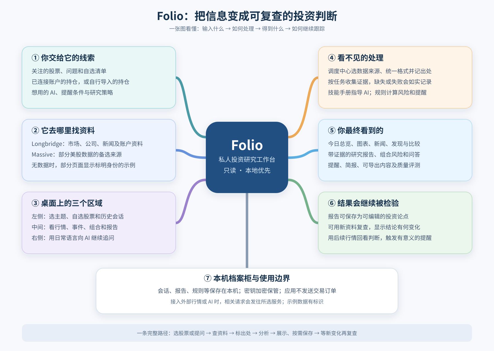

# Folio 项目思维导图

## 用一分钟理解

Folio 是一张放在电脑上的“投资研究桌”。你告诉它关注哪只股票、持有哪些资产，或直接提出问题。它从已连接的数据服务取资料，记录资料来自哪里，再把资料做成行情页面、研究报告、AI 回答、组合分析和提醒。报告还能保存为投资论点，以后拿新资料复查，也能回看之前的判断。

## 一条真实的数据路径

1. **输入：**在左侧选股票、在右侧提问，或从工作台发起深度研究；当前股票会作为问题的上下文。
2. **取数：**桌面程序通过数据连接器查询 Longbridge；适用时可由 Massive 提供美股备选数据。连接不可用时，部分界面展示带“示例数据”标识的内置内容。
3. **整理：**数据转换成统一的行情、公司、新闻、持仓等资料；系统记录实际来源、获取时间及失败情况。
4. **分析：**普通页面直接展示资料；深度研究按选定策略收集证据，再由 AI（或本地演示模式）归纳成报告；规则引擎计算提醒、风险和定期任务。
5. **输出：**用户看到 Today 总览、证券工作台、发现、比较、研究报告、投资组合、提醒，以及流式显示的 AI 回答。研究报告包含可追溯的证据。
6. **后续：**保存报告为投资论点，按需用新数据重评；新旧报告可比较；到期后可用后续行情评估以前的判断。设定的提醒和自动任务在应用运行时定期检查。

## 输入与输出对照

| 你提供的输入 | Folio 给出的输出 |
| --- | --- |
| 股票代码、自选清单 | 行情、图表、公司资料、新闻和市场事件 |
| 一句问题和当前查看的股票 | 带工具过程与来源线索的实时 AI 回答 |
| 研究策略与目标股票 | 带证据、风险、看多/看空理由的研究报告 |
| 已连接账户的持仓，或手动导入的持仓 | 组合概览、盈亏、集中度和风险分析 |
| 保存的投资论点、提醒条件 | 后续复查、结论变化、提醒和简报 |
| 已完成的研究与后续行情 | 旧判断的结果评估、技能/策略表现与评测视图 |

## 代码里各部分对应什么

| 非技术说法 | 实际位置 | 作用 |
| --- | --- | --- |
| 看得见的桌面 | [`packages/ui/src/components`](../packages/ui/src/components) | 展示页面、接收点击与提问 |
| 桌面的调度中心 | [`apps/electron/src/main/kernelHost.ts`](../apps/electron/src/main/kernelHost.ts) | 接收界面请求，组合各项服务，管理本机数据 |
| 安全传话筒 | [`apps/electron/src/preload/index.ts`](../apps/electron/src/preload/index.ts) | 只把允许的操作交给界面 |
| 资料入口 | [`packages/shared/src/providers`](../packages/shared/src/providers) | 连接 Longbridge / Massive，选择可用来源 |
| 统一的资料菜单 | [`packages/shared/src/capabilities`](../packages/shared/src/capabilities) | 定义哪些只读查询可以执行，保留来源和执行结果 |
| 技能手册 | [`packages/skill-hub/src`](../packages/skill-hub/src)、[`skills`](../skills) | 按需向 AI 提供任务说明、相关资料和可用能力 |
| 研究流水线 | [`packages/shared/src/research`](../packages/shared/src/research) | 规划取数、保存检查点、归纳并发布报告 |
| AI 对话与实时回答 | [`packages/shared/src/kernel`](../packages/shared/src/kernel)、[`packages/shared/src/agent`](../packages/shared/src/agent) | 管理会话、运行、工具调用与回答事件 |
| 发现与比较 | [`packages/shared/src/screening`](../packages/shared/src/screening)、[`packages/shared/src/compare`](../packages/shared/src/compare) | 筛出候选标的并比较证券 |
| 后续复查与提醒 | [`packages/shared/src/thesis`](../packages/shared/src/thesis)、[`packages/shared/src/alerts`](../packages/shared/src/alerts)、[`packages/shared/src/automation`](../packages/shared/src/automation) | 复评投资论点、检查规则、安排定期任务 |
| 质量检查 | [`packages/shared/src/evaluation`](../packages/shared/src/evaluation)、[`packages/shared/src/outcome`](../packages/shared/src/outcome) | 评估 AI 运行质量，回看研究判断的后续结果 |
| 本机档案柜 | [`packages/shared/src/storage`](../packages/shared/src/storage) | 保存会话、消息、运行记录及业务结果 |

**使用边界：**Folio 只做研究和决策支持，不提供下单能力。会话和研究状态主要存于本机，密钥由桌面程序加密保管；连接外部行情或 AI 服务时，相应请求仍需发往所选服务。普通界面的示例回退与 AI 的离线演示是不同路径，后者需启用演示配置。
